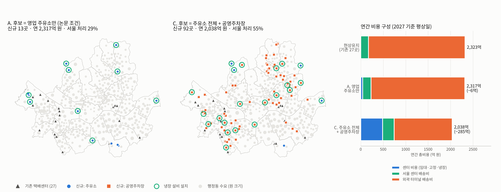

# 서울 도심형 물류센터 입지 최적화 (YPICS 19기 내부세미나)

2027년 서울 택배 수요를 예측하고, 기존 택배센터 27곳에 더해 **주유소·공영주차장** 중 어디에 도심 물류센터를 열면
연간 비용(임대료 + 고정비 + 배송비)이 가장 작아지는지 혼합정수계획으로 푼다.
모든 행정동에 20분 안에 닿는 센터가 있어야 한다는 서비스 수준을 지키고, 신선식품은 냉장 센터만 처리한다.

- 대상 논문: 강명구 외(2024), 「배송 차량 이동시간을 고려한 도심형 물류센터 최적 입지 선정」, 물류과학기술연구 5(1)
- 논문과 다른 점: 후보지 확장(폐업·휴업 주유소, 공영주차장), 공시지가 기반 임대료와 고정비, 기존 센터 반영, 2027 수요 예측, 신선식품(냉장) 구분

## 결과 (2027 기준 시나리오 평상일)



| | 현상유지 (기존 27곳만) | A: 영업 주유소만 (논문 조건) | C: 주유소 전체 + 공영주차장 |
|---|---|---|---|
| 신규 센터 | 0 | 13곳 (냉장 9) | 92곳 (공영주차장 87, 냉장 22) |
| 연간 총비용 | 2,323억 원 | 2,317억 원 | 2,038억 원 |
| 현상유지 대비 절감 | — | 6억 원 | 285억 원 |
| 서울 센터 처리 비율 | 27% | 29% | 55% |
| 1개당 비용 | 164원 | 164원 | 144원 |

- 주유소는 부지가 작고(처리 용량 중앙값 약 3,700개/일) 땅값이 비싸(공시지가 중앙값 ㎡당 725만 원) 센터를 열어도 이득이 거의 없다. A의 신규 13곳 중 6곳은 20분 커버를 맞추기 위한 것이다.
- 공영주차장은 넓고(약 1.2만 개/일) 땅값이 절반 수준(371만 원)이라, 후보에 넣으면 서울 처리 비율이 두 배가 된다.
- 비용의 대부분이 외곽 터미널 배송비라서, 절감액은 '외곽 편도 45분' 가정에 따라 달라진다.

## 빠르게 실행하기 (원본 데이터 없이)

`data/processed/` 에 전처리 결과가 들어 있어서 최적화만 바로 돌릴 수 있다.

```bash
pip install -r requirements.txt
python scripts/12_run_compare.py     # 현상유지 / A / C 비교 → results/final/
python scripts/13_plot_compare.py    # 그림 → results/final/compare_A_C.png
```
Gurobi가 있으면 `python scripts/12_run_compare.py --solver gurobi`.

## 처음부터 다시 만들기

1. `data/raw/README.md` 대로 원본 파일을 `data/raw/` 에 넣는다 (출처: `docs/데이터출처.md`).
2. 아래 순서대로 실행한다. 모든 스크립트는 저장소 최상위 폴더에서 `python scripts/<파일>` 로 돌린다.

| 순서 | 스크립트 | 하는 일 | 결과 (`data/processed/`) |
|---|---|---|---|
| 0 | `00_unzip_raw.py` | 원본 압축 풀기 | `data/raw/lev6, umd, gsj` |
| 1 | `01_network.py` | 상세도로망 + View-T 속도 → 시간대별 방향 그래프 | `network/` |
| 2 | `02_boundary.py` | 법정동 → 자치구·서울 경계 | `boundary/` |
| 3 | `03_candidates.py` | 주유소·공영주차장·기존 창고 후보지, 좌표 통일, 공시지가 임대료 | `candidates/` |
| (3') | `05_geocode_kakao.py` → `03_candidates.py` 다시 | 좌표 없는 후보지 카카오 지오코딩 (API 키 필요, 결과 `kakao_geocode.csv` 는 이미 포함) | `candidates/` |
| 4 | `04_check_map.py` | 속도·후보지 점검 지도 | `results/check_map.png` |
| 5 | `05a_living_population.py` | 행정동 생활인구 → 야간인구 비중 | `demand/행정동_야간인구_202607.csv` |
| 6 | `06_hjd_boundary.py` | 행정동 경계 ↔ 생활인구 코드 맞추기, 수요점 | `boundary/hjd*`, `demand/` |
| 7 | `07a_life_logistics.py` | 생활물류 72개 월 파일 → 일 × 자치구 × 품목 | `demand/생활물류_일별_구_품목.csv` |
| 8 | `07_demand_forecast.py` | 2027 수요 예측(시나리오·피크) → 행정동 배분 | `demand/수요_2027_*.csv` |
| 9 | `08_travel_matrix.py` | 후보지 → 행정동 최단 이동시간(다익스트라) | `model/tt_*.csv.gz` |
| 10 | `12_run_compare.py`, `13_plot_compare.py` | 최종 비교 실험과 그림 | `results/final/` |

장래인구 추계(`demand/장래인구_자치구_2022_2042.csv`)는 서울시 보고서 PDF 부록 표에서 옮긴 값이라 스크립트 없이 포함했다.
2026-11-16 기준으로 위 순서를 처음부터 다시 돌려 `data/processed/` 와 `results/final/` 이 같은 값으로 나오는 것을 확인했다.

### 탐색 단계 스크립트 (`results/exploratory/`)
- `09_optimize.py`: 2단계 확률계획(성장 3 × 평상/피크 6개 시나리오), EV·RP·EEV·VSS 비교. VSS가 거의 0이라 최종안은 결정론 모형으로 정함
- `10_ucurve.py`, `11_plot_results.py`: 센터 수별 비용 곡선, 벌점·고정비 민감도
- `optional/bigdata_campus_aggregate.py`: 서울시 빅데이터캠퍼스 반출용 집계 (선택)

## 주요 가정 (팀 결정 2026-11-16)
| 항목 | 값 |
|---|---|
| 목표 연도 · 설계 수요 | 2027, 기준 시나리오(전국 연 7.8% 성장) 평상일 |
| 서비스 수준 | 모든 행정동 20분 안에 센터(신선은 냉장 센터), 평일 11시 이동시간 |
| 센터 역할 | 전체 택배(일반 + 신선) |
| 처리 용량 | 부지면적 × 4개/㎡·일, 복층 개발 없음 |
| 비용 | 임대료 = 면적 × 공시지가 × 5.5%, 냉장 × 1.87, 고정비 1억(용량 1만 개/일 미만)·2억(이상), 운행비 380원/분 |
| 외곽 터미널 배송 | 서울 센터가 처리 못 한 물량은 편도 45분 거리에서 배송(201원/개, 신선 1.5배) |
| 기존 센터 | 서울시 물류창고업 등록 중 운송·택배 업태 27곳 (택배사 서브터미널 일부 누락 가능) |

근거와 재확인이 필요한 값은 `docs/데이터출처.md`, 수식은 `docs/최적화모형.md`.

## 폴더 구조
```
config.py            경로 설정 (data/raw, data/processed, results)
scripts/             00~13 실행 스크립트
data/raw/            원본 데이터 (저장소 미포함)
data/processed/      전처리 결과 (도로망·경계·후보지·수요·이동시간 행렬)
results/final/       최종 비교 결과와 그림
results/exploratory/ 2단계 확률모형·민감도 등 탐색 결과
docs/                데이터 출처, 최적화 수식, 전처리 상세 기록
```

## 주의
- 저장소는 비공개로 둔다. `data/processed/network/` 에 View-T 속도 가공값이 들어 있어, 공개 전에 View-T 이용 조건을 확인한다.
- 카카오 REST API 키는 환경변수 `KAKAO_REST_KEY` 로만 넣고 커밋하지 않는다.
