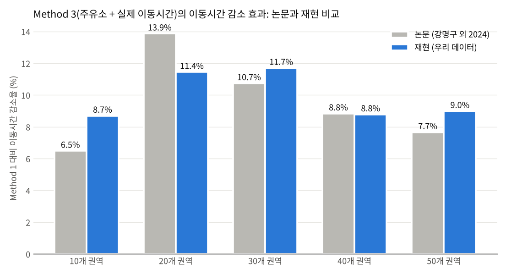
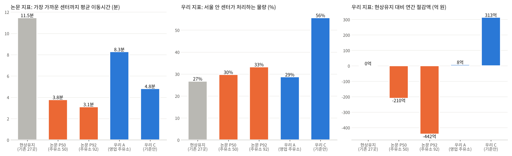
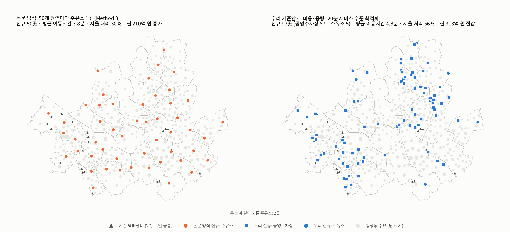
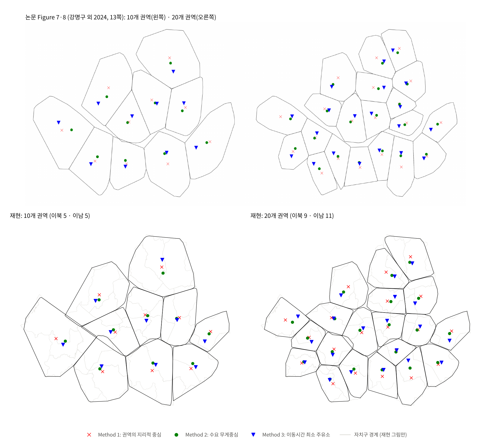

# 서울 도심형 물류센터 입지 최적화 (YPICS 19기 내부세미나)

2027년 서울 택배 수요를 예측하고, 기존 택배센터 27곳에 더해 **주유소·공영주차장** 중 어디에 도심 물류센터를 열면
연간 비용(임대료 + 고정비 + 배송비)이 가장 작아지는지 혼합정수계획으로 푼다.
모든 행정동에 20분 안에 닿는 센터가 있어야 한다는 서비스 수준을 지키고, 신선식품은 냉장 센터만 처리한다.

- 대상 논문: 강명구 외(2024), 「배송 차량 이동시간을 고려한 도심형 물류센터 최적 입지 선정」, 물류과학기술연구 5(1)
- 논문과 다른 점: 후보지 확장(폐업·휴업 주유소, 공영주차장), 공시지가 기반 임대료와 고정비, 기존 센터 반영, 2027 수요 예측, 신선식품(냉장) 구분

## 결과 (2027 기준 시나리오 평상일)


| | 현상유지 (기존 27곳만) | A: 영업 주유소만 (논문 조건) | C: 주유소 전체 + 공영주차장 |
|---|---|---|---|
| 신규 센터 | 0 | 13곳 (냉장 9) | 92곳 (공영주차장 87, 냉장 22) |
| 연간 총비용 | 2,323억 원 | 2,315억 원 | 2,010억 원 |
| 현상유지 대비 절감 | — | 8억 원 | 313억 원 (−13.5%) |
| 서울 센터 처리 비율 | 27% | 29% | 56% |
| 1개당 비용 | 164원 | 164원 | 142원 |

- 주유소는 부지가 작고(처리 용량 중앙값 약 3,700개/일) 땅값이 비싸(공시지가 중앙값 ㎡당 725만 원) 센터를 열어도 이득이 거의 없다. A의 신규 13곳 중 6곳은 20분 커버를 맞추기 위한 것이다.
- 공영주차장은 넓고(약 1.2만 개/일) 땅값이 절반 수준(371만 원)이라, 후보에 넣으면 서울 처리 비율이 두 배가 된다.
- 비용은 개설 위치를 고정하고, 개설 센터 중 20분 안의 모든 센터를 배정 후보로 써서 계산한 값이다.
- 현상유지는 20분 안에 센터가 없는 동이 일반 36곳·냉장 189곳이고, C는 둘 다 0곳이다.
- 비용의 대부분이 외곽 터미널 배송비라서, 절감액은 '외곽 편도 45분' 가정에 따라 달라진다.

## 적정 센터 수와 손익분기 (`scripts/19_ucurve_final.py` → `results/slides/ucurve_final.csv`)

신규 센터 수 k를 고정하고(Σy = k) 20분 커버·냉장 커버를 지킨 채 k별 최소 연간비용을 구했다. 비용은 위와 같은 방식으로 계산했다.

| 신규 센터 수 | 0 (현상유지) | 20 | 50 | 92 (최적) | 110 | 310 | 315 |
|---|---|---|---|---|---|---|---|
| 연간 총비용 (억) | 2,323 | 2,110 | 2,036 | **2,010** | 2,013 | 2,317 | 2,326 |
| 현상유지 대비 (억) | — | −213 | −287 | **−313** | −310 | −6 | +3 |

- 최적은 신규 92곳으로 연 313억(−13.5%) 절감한다. 80~110곳 구간은 최적과 4억 이내로 거의 같다.
- 처음 20곳만으로도 절감액의 약 68%(213억)를 얻는다.
- 손익분기는 약 310곳이다. 그 이상은 현상유지보다 비싸지고, 92곳을 넘는 센터는 비용만 늘린다.
- 외곽 편도 시간 민감도(바깥쪽 가정만 바꿔 계산): 30분이면 최적 42곳·손익분기 약 120곳, 45분(기준)이면 92곳·약 310곳, 60분이면 163곳·약 500곳.

## 대상 논문과 비교 (`scripts/14_paper_replication.py`, `15_cross_eval.py`)

**① 논문 재현.** 논문 절차(K-Means 권역 → 권역별 Method 1~3 → 2021 속도 6개 시간대 × 랜덤 시나리오 100개 → 프리드먼·Conover 검정)를 우리 데이터로 다시 돌렸다.
Method 1(지리적 중심) 대비 Method 3(주유소 + 실제 이동시간)의 이동시간 감소율이 논문과 같은 수준으로 나와, 데이터와 전처리가 논문과 같은 경향을 낸다는 것을 확인했다.



| 권역 수 | 10 | 20 | 30 | 40 | 50 |
|---|---|---|---|---|---|
| 논문 감소율 | 6.5% | 13.9% | 10.7% | 8.8% | 7.7% |
| 재현 감소율 | 8.7% | 11.4% | 11.7% | 8.8% | 9.0% |
| 재현 점당 평균 이동시간 (M1 → M3) | 8.5 → 7.7분 | 6.7 → 5.9분 | 6.0 → 5.3분 | 5.2 → 4.8분 | 4.9 → 4.4분 |

- 프리드먼 검정은 모든 권역 수에서 p < 0.001, Conover 사후검정도 세 방법 간 차이가 모두 유의했다(논문은 30개 권역 M2–M3만 유의하지 않음).
- 논문 Table 3의 절대값은 '권역 내 이동시간 총합'이라 수요점 수에 따라 달라져 직접 비교하지 않고 감소율로 비교했다.
- 데이터 차이: 논문 수요는 생활물류 블록(68,216개) 단위, 재현은 행정동 단위 수요를 경계 안에 고르게 뿌렸다. 후보 주유소는 논문 396곳, 재현은 도로 연결·공시지가가 확인된 385곳.

**② 교차 평가.** 논문 방식 해(Method 3, 50·92개 권역)와 우리 해를 서로의 지표로 평가했다. 모두 기존 27곳은 운영 중이라고 보고, 개설을 고정한 채 12번 모형으로 비용을 다시 계산했다.



| | 현상유지 | 논문 P50 | 논문 P92 | 우리 A | 우리 C (기준안) |
|---|---|---|---|---|---|
| 신규 센터 | 0 | 주유소 50 | 주유소 92 | 주유소 13 | 92 (공영주차장 87) |
| [논문 지표] 가장 가까운 센터까지 평균 이동시간 (2021, 6개 시간대) | 11.5분 | 3.8분 | 3.1분 | 8.3분 | 4.8분 |
| [우리 지표] 서울 센터 처리 비율 | 27% | 30% | 33% | 29% | 56% |
| [우리 지표] 연간 총비용 | 2,323억 | 2,533억 | 2,765억 | 2,315억 | 2,010억 |
| [우리 지표] 현상유지 대비 | — | +210억 | +442억 | −8억 | −313억 |

- 논문 방식은 이동시간을 가장 짧게 만들지만, 작은 주유소를 권역마다 열어 처리량은 거의 늘지 않고 임대료·고정비만 늘어 현상유지보다 비싸진다.
- 우리 기준안은 평균 이동시간을 논문 방식보다 1~1.7분 내주는 대신 처리량을 두 배로 늘리고 연 313억 원을 아낀다.

**③ 신규 MFC 위치 비교 지도** (`scripts/16_plot_paper_vs_ours.py [50|92]`)



- 논문 방식은 권역마다 1곳씩 뽑아 서울 전역에 고르게 퍼진다 (강남 5, 은평 4, 성북·강서·영등포 3).
- 우리 C는 땅값이 싸고 기존 센터가 멀거나 없는 동북권(중랑 14, 강북 9)과 서남권(구로 7, 금천 6)에 몰린다.
- 두 안이 같이 고른 주유소는 2곳뿐이다. 같은 92곳으로 맞춘 비교는 `map_paper_vs_ours_P92.png`.

**④ 논문 Figure 7·8과 같은 형식으로 비교** (`scripts/17_plot_paper_fig78.py`)



- 10개 권역은 권역 배치(이북 5·이남 5, 한강을 경계로 나뉜 모양)가 논문 그림과 거의 같고, 20개 권역도 전체 구도가 비슷하다.
- 논문의 관찰 "수요 무게중심(Method 2)은 인구 밀도 때문에 한강 쪽으로 치우치고, Method 3은 그렇지 않다"도 재현됐다. Method 2가 지리적 중심보다 한강에 가까운 권역은 10개 중 8개·20개 중 13개, Method 3은 10개 중 6개·20개 중 10개로 방향이 섞인다.
- 개별 점의 위치는 권역마다 조금씩 다르다. 수요 단위(블록 vs 행정동)와 무작위 점이 달라서다.
- `_paper_fig78.png`는 논문 13쪽 그림을 잘라 낸 것이라 저장소를 공개할 때는 빼야 한다.

## 빠르게 실행하기 (원본 데이터 없이)

`data/processed/` 에 전처리 결과가 들어 있어서 최적화만 바로 돌릴 수 있다.

```bash
pip install -r requirements.txt
python scripts/12_run_compare.py     # 현상유지 / A / C 비교 → results/final/
python scripts/13_plot_compare.py    # 그림 → results/final/compare_A_C.png
```
Gurobi가 있으면 `python scripts/12_run_compare.py --solver gurobi`.

## 처음부터 다시 만들기

1. `data/raw/README.md` 대로 원본 파일을 `data/raw/` 에 넣는다 (출처: `docs/데이터출처.md`).
2. 아래 순서대로 실행한다. 모든 스크립트는 저장소 최상위 폴더에서 `python scripts/<파일>` 로 돌린다.

| 순서 | 스크립트 | 하는 일 | 결과 (`data/processed/`) |
|---|---|---|---|
| 0 | `00_unzip_raw.py` | 원본 압축 풀기 | `data/raw/lev6, umd, gsj` |
| 1 | `01_network.py` | 상세도로망 + View-T 속도 → 시간대별 방향 그래프 | `network/` |
| 2 | `02_boundary.py` | 법정동 → 자치구·서울 경계 | `boundary/` |
| 3 | `03_candidates.py` | 주유소·공영주차장·기존 창고 후보지, 좌표 통일, 공시지가 임대료 | `candidates/` |
| (3') | `05_geocode_kakao.py` → `03_candidates.py` 다시 | 좌표 없는 후보지 카카오 지오코딩 (API 키 필요, 결과 `kakao_geocode.csv` 는 이미 포함) | `candidates/` |
| 4 | `04_check_map.py` | 속도·후보지 점검 지도 | `results/check_map.png` |
| 5 | `05a_living_population.py` | 행정동 생활인구 → 야간인구 비중 | `demand/행정동_야간인구_202607.csv` |
| 6 | `06_hjd_boundary.py` | 행정동 경계 ↔ 생활인구 코드 맞추기, 수요점 | `boundary/hjd*`, `demand/` |
| 7 | `07a_life_logistics.py` | 생활물류 72개 월 파일 → 일 × 자치구 × 품목 | `demand/생활물류_일별_구_품목.csv` |
| 8 | `07_demand_forecast.py` | 2027 수요 예측(시나리오·피크) → 행정동 배분 | `demand/수요_2027_*.csv` |
| 9 | `08_travel_matrix.py` | 후보지 → 행정동 최단 이동시간(다익스트라) | `model/tt_*.csv.gz` |
| 10 | `12_run_compare.py`, `13_plot_compare.py` | 최종 비교 실험과 그림 | `results/final/` |
| 11 | `14_paper_replication.py`, `15_cross_eval.py`, `16_plot_paper_vs_ours.py`, `17_plot_paper_fig78.py` | 대상 논문 재현, 교차 평가, 위치 비교 지도 | `results/paper_compare/` |

장래인구 추계(`demand/장래인구_자치구_2022_2042.csv`)는 서울시 보고서 PDF 부록 표에서 옮긴 값이라 스크립트 없이 포함했다.
2026-11-16 기준으로 위 순서를 처음부터 다시 돌려 `data/processed/` 와 `results/final/` 이 같은 값으로 나오는 것을 확인했다.

### 탐색 단계 스크립트 (`results/exploratory/`)
- `09_optimize.py`: 2단계 확률계획(성장 3 × 평상/피크 6개 시나리오), EV·RP·EEV·VSS 비교. VSS가 거의 0이라 최종안은 결정론 모형으로 정함
- `10_ucurve.py`, `11_plot_results.py`: 센터 수별 비용 곡선, 벌점·고정비 민감도
- `optional/bigdata_campus_aggregate.py`: 서울시 빅데이터캠퍼스 반출용 집계 (선택)

## 주요 가정 (팀 결정 2026-11-16)
| 항목 | 값 |
|---|---|
| 목표 연도 · 설계 수요 | 2027, 기준 시나리오(전국 연 7.8% 성장) 평상일 |
| 서비스 수준 | 모든 행정동 20분 안에 센터(신선은 냉장 센터), 평일 11시 이동시간 |
| 센터 역할 | 전체 택배(일반 + 신선) |
| 처리 용량 | 부지면적 × 4개/㎡·일, 복층 개발 없음 |
| 비용 | 임대료 = 면적 × 공시지가 × 5.5%, 냉장 × 1.87, 고정비 1억(용량 1만 개/일 미만)·2억(이상), 운행비 380원/분 |
| 외곽 터미널 배송 | 서울 센터가 처리 못 한 물량은 편도 45분 거리에서 배송(201원/개, 신선 1.5배) |
| 기존 센터 | 서울시 물류창고업 등록 중 운송·택배 업태 27곳 (택배사 서브터미널 일부 누락 가능) |

근거와 재확인이 필요한 값은 `docs/데이터출처.md`, 수식은 `docs/최적화모형.md`.

## 폴더 구조
```
config.py            경로 설정 (data/raw, data/processed, results)
scripts/             00~13 실행 스크립트
data/raw/            원본 데이터 (저장소 미포함)
data/processed/      전처리 결과 (도로망·경계·후보지·수요·이동시간 행렬)
results/final/       최종 비교 결과와 그림
results/exploratory/ 2단계 확률모형·민감도 등 탐색 결과
results/paper_compare/ 대상 논문 재현·교차 평가
docs/                데이터 출처, 최적화 수식, 전처리 상세 기록
```

## 주의
- 저장소는 비공개로 둔다. `data/processed/network/` 에 View-T 속도 가공값이 들어 있어, 공개 전에 View-T 이용 조건을 확인한다.
- 카카오 REST API 키는 환경변수 `KAKAO_REST_KEY` 로만 넣고 커밋하지 않는다.
